<h1 align="center">calligram</h1>
<p align="center"><b>Word clouds in any shape, from survey text to maps, for Stata</b></p>

<p align="center">
<a href="https://fahad-mirza.github.io/calligram_Stata/"></a>


</p>

<p align="center">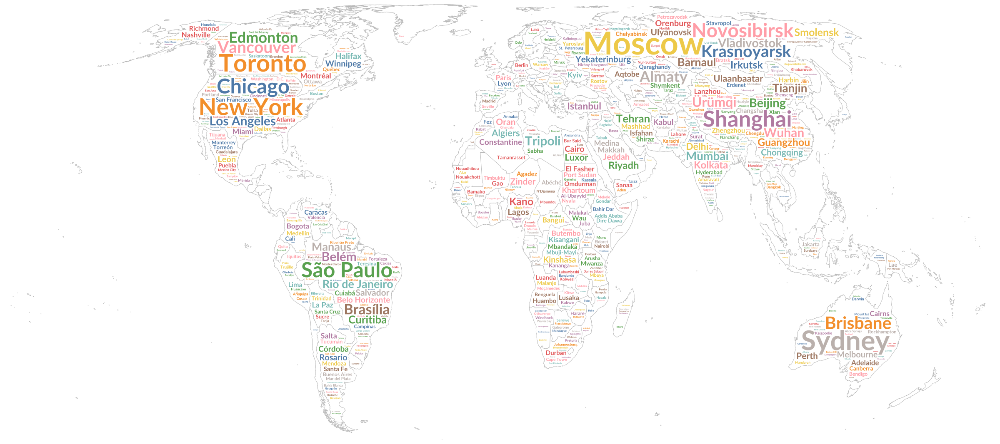</p>

> *A calligram is text arranged to form a picture.* **calligram** turns open-ended survey answers, documents or any text into word clouds: interactive web pages that work offline, plus PNG, JPG or SVG pictures. Words are packed by the shape of their letters and never overlap. They can fill a heart, a star, your own logo, a shape drawn from coordinates, or a map with every word inside its own country.
>
> *Formerly `wordcloud2`.*

### 👉 [Open the live, interactive gallery](https://fahad-mirza.github.io/calligram_Stata/)

Every picture in this README links to the real page Stata wrote. Open one and try searching, filtering, hovering, zooming and clicking the key.

<table>
<tr>
<td width="50%">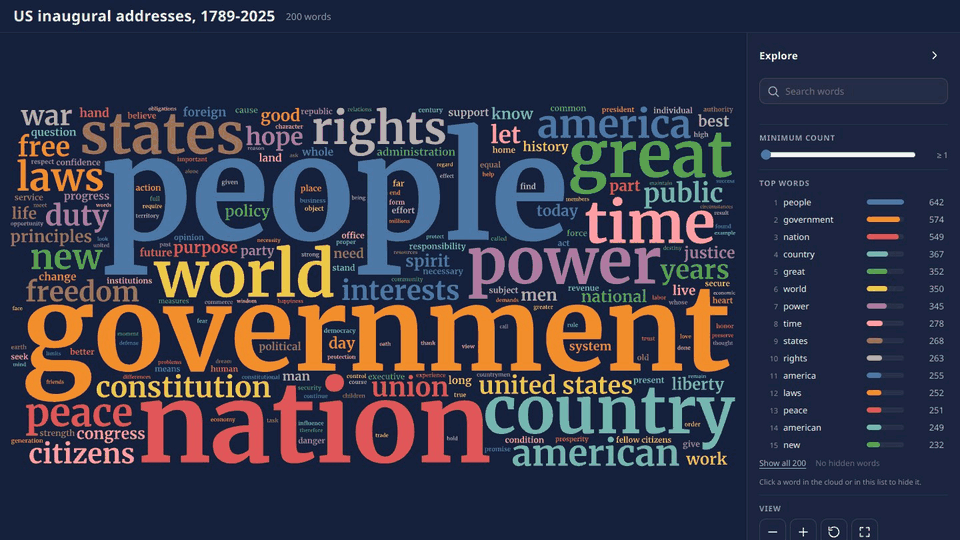<br><sub><b>Explore:</b> search, set a minimum count, hover for counts and shares</sub></td>
<td width="50%">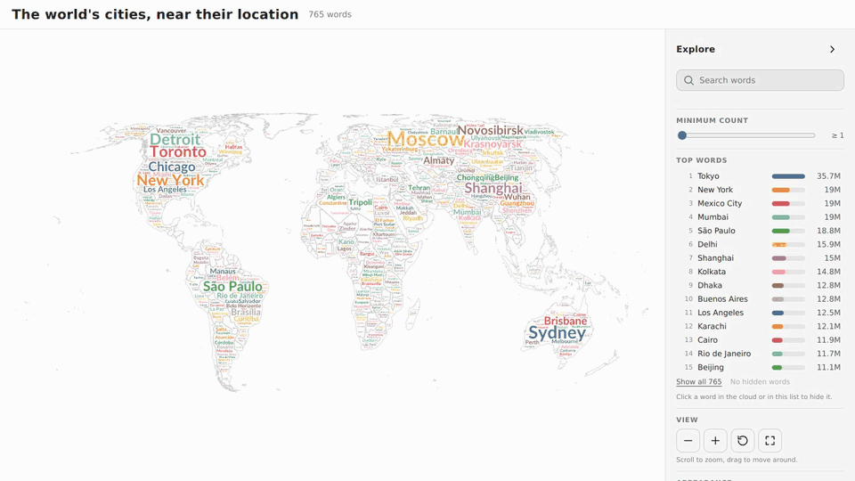<br><sub><b>Zoom and pan:</b> scroll to zoom, drag to move around</sub></td>
</tr>
<tr>
<td width="50%">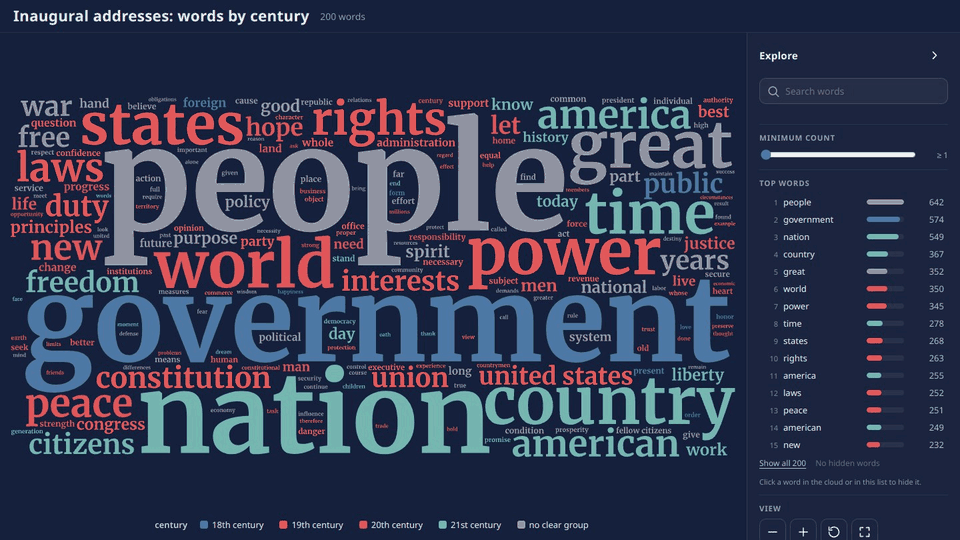<br><sub><b>Colour with meaning:</b> click the key to hide or show a group</sub></td>
<td width="50%">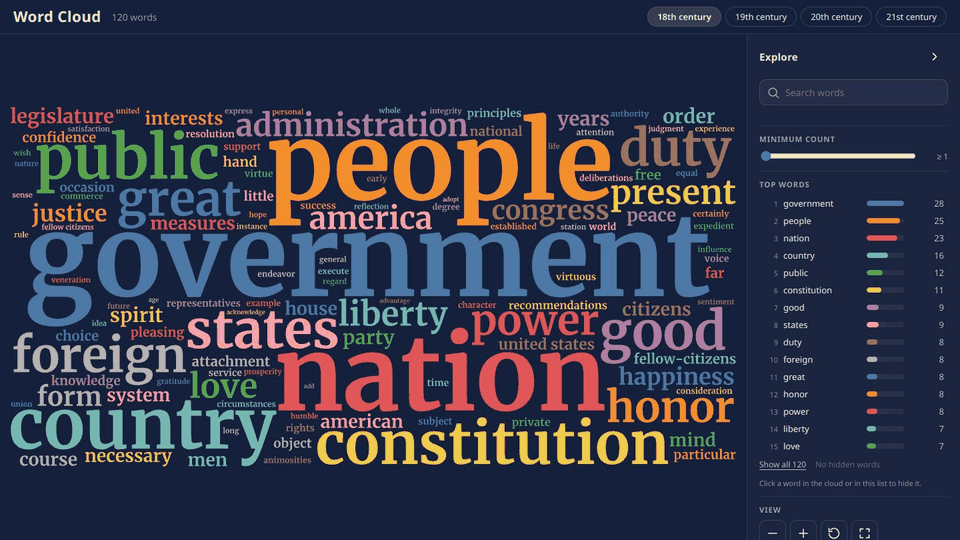<br><sub><b>One cloud per group:</b> <code>by()</code> gives tabs</sub></td>
</tr>
</table>

---

## Contents

- [Why calligram](#why-calligram)
- [Install](#install)
- [Quick start](#quick-start)
- [Gallery](#gallery): [basics](#the-basics) · [shapes](#shapes) · [maps](#maps) · [text](#working-with-text) · [every language](#every-language-and-writing-system) · [Urdu in Nastaliq](#urdu-in-nastaliq) · [colour with meaning](#colour-with-meaning) · [results and speed](#results-and-speed)
- [The interactive page](#the-interactive-page)
- [Options](#options)
- [Stored results](#stored-results)
- [How it works](#how-it-works)
- [Requirements and troubleshooting](#requirements-and-troubleshooting)
- [FAQ](#faq)
- [Credits and licence](#credits-and-licence)

---

## Why calligram

- **Nothing to install but the package.** A Java engine bundled in the package runs on Stata's own Java. There's no Python, R, or internet connection needed.
- **Tight, clean layouts.** Words are packed by the exact pixels of their letters, not their bounding boxes, so the cloud is dense and no two words ever touch.
- **Any shape.** Nine built-in shapes, any black-on-white picture, any shape from coordinates, or a map from a Stata shapefile with each word inside its own area.
- **Every language and writing system.** Urdu and Hindi, Arabic, Persian and Hebrew (right to left, letters joined), Bengali, Tamil and Thai (vowel signs in place), Chinese, Japanese and Korean. Urdu can be drawn in **Nastaliq**, its own calligraphic style, with a bundled font. [See below](#every-language-and-writing-system).
- **Text handling that suits survey data.** Stopwords in English, French, Spanish and Portuguese; plurals merged with their singulars; hyphenated words kept whole; contractions handled; two-word phrases detected statistically; weights; `if`/`in`; `by()` groups; and words you've already counted.
- **Colour that means something.** Colour words by a numeric variable (average rating, sentiment, year), by the group each word is typical of, by a colour you choose for each word, or from a picture.
- **Pages that work anywhere.** One self-contained HTML file that works offline, with search, filtering, a top-words list, hover cards, zoom and pan, light and dark themes, palettes, and PNG/SVG/JPG saving. The same picture can also be written straight from Stata with `image()`.
- **Fast.** About 3 million words counted in under a second on 8 cores.
- **Reproducible.** The same data and options always give the same cloud. Change `seed()` for a different arrangement.

## Install

```stata
net install calligram, from("https://raw.githubusercontent.com/fahad-mirza/calligram_Stata/main/") replace
* the example data used below (into the current folder)
net get calligram, from("https://raw.githubusercontent.com/fahad-mirza/calligram_Stata/main/")
help calligram
```

Requires Stata 17 or newer, on Windows, macOS or Linux.

## Quick start

```stata
use cg_inaugural, clear              // US inaugural addresses, one row per paragraph
calligram, textvar(text)             // writes calligram.html: click the path shown to open it
```

Add options as you need them:

```stata
calligram, textvar(text) phrases shape(heart) title("Inaugural addresses") ///
    savefile(inaugural.html) image(inaugural.png, replace)
```

---

## Gallery

All examples come from [`calligram_gallery.do`](calligram_gallery.do), which builds each page and picture. Click a picture to open its interactive page. In the gallery, religious words (such as *god*, *faith* or *blessings*, frequent in the inaugural addresses) are left out with `stopwords()`; the commands below omit that list for brevity.

### The basics

#### Survey responses
Sixteen open-ended answers, cleaned (lower case, punctuation removed, contractions handled), stopwords removed, counted and packed.

```stata
calligram, textvar(response) minfreq(1)
```
<a href="https://fahad-mirza.github.io/calligram_Stata/examples/01_survey.html"></a>

#### A title, a light background and a gradient
```stata
calligram, textvar(response) minfreq(1) bgcolor(white) ///
    gradient(#1d3557 #e63946) title("What customers said")
```
<a href="https://fahad-mirza.github.io/calligram_Stata/examples/02_gradient.html">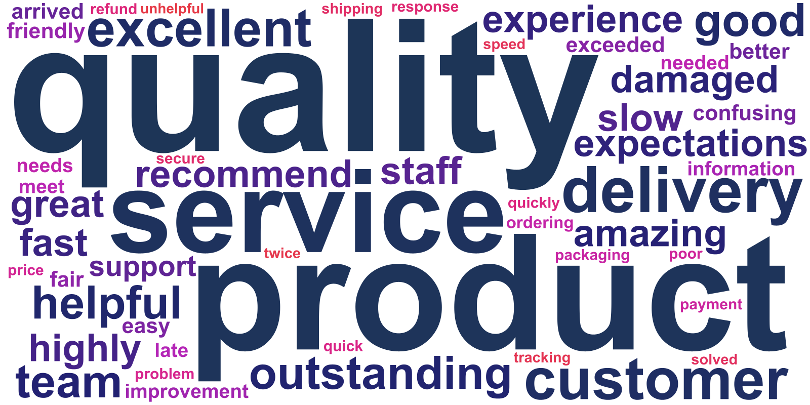</a>

#### Rotated words and another font
Seven fonts are bundled (Arimo, Tinos, Roboto, Open Sans, Lato, Noto Sans and Merriweather), so pages look identical on every computer. Any font installed on your system works too.

```stata
calligram, textvar(response) minfreq(1) rotate(random) font(Roboto)
```
<a href="https://fahad-mirza.github.io/calligram_Stata/examples/03_rotated.html"></a>

### Shapes

#### Built-in shapes
`shape()` takes rectangle (the default), ellipse, circle, square, cloud, heart, diamond, triangle or star. `outline` draws the edge.

```stata
use cg_inaugural, clear
calligram, textvar(text) shape(heart) width(1000) height(900) maxwords(250) rotate(random)
calligram, textvar(text) shape(star) outline width(1000) height(1000) maxwords(250) font(Lato)
```
<table><tr>
<td><a href="https://fahad-mirza.github.io/calligram_Stata/examples/04_heart.html"></a></td>
<td><a href="https://fahad-mirza.github.io/calligram_Stata/examples/04_star.html">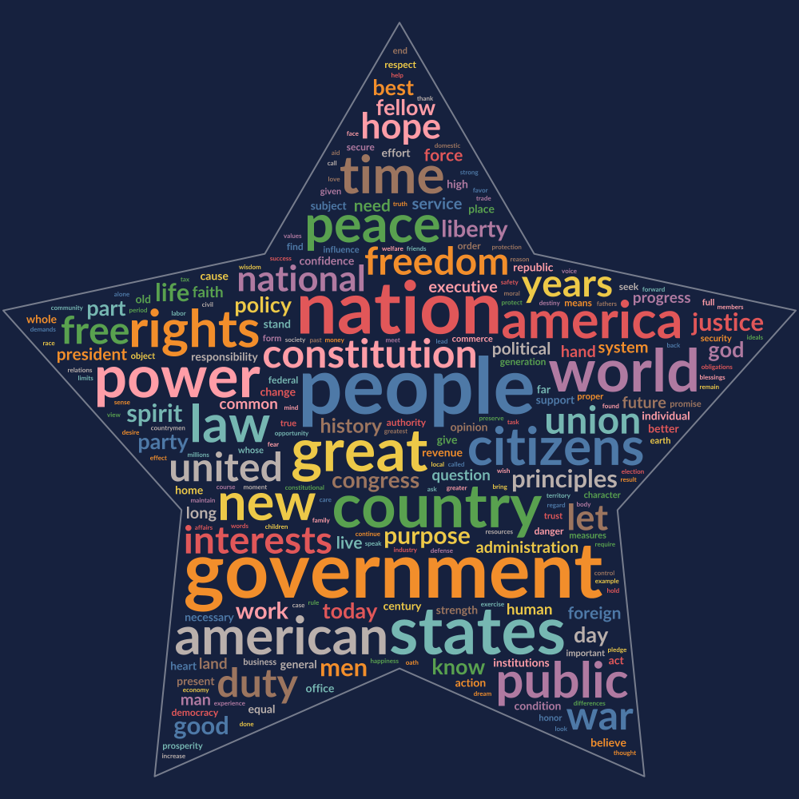</a></td>
</tr></table>

#### Any shape you can describe with coordinates
Save points as `_ID`, `_X`, `_Y` and you have a one-area shapefile, which `shapes()` fills exactly. Here a wobbly blob is drawn in Stata:

```stata
clear
set seed 2024
set obs 2881
gen double t = (_n - 1) * 2 * _pi / 2880
gen double r = 1 + 0.15*sin(2*t + 1) + 0.12*sin(3*t + 2) + 0.18*sin(5*t + 4)
gen double _X = r * cos(t)
gen double _Y = r * sin(t)
gen byte _ID = 1
gen int shape_order = _n
save blob_shp, replace

use cg_inaugural, clear
calligram, textvar(text) shapes(blob_shp.dta) projection(none) outline ///
    width(1000) height(1000) maxwords(300) phrases rotate(90) font(Roboto)
```

#### ... or from a picture
Any black-on-white image works with `mask()`, including a Stata graph you export. White margins are cropped automatically.

```stata
* blob_mask.png: the blob drawn with twoway and saved with graph export
* (full code in calligram_gallery.do)
calligram, textvar(text) mask(blob_mask.png) outline width(1000) height(1000) ///
    maxwords(300) rotate(random) font(Lato)
```
<table><tr>
<td><a href="https://fahad-mirza.github.io/calligram_Stata/examples/05_blob.html">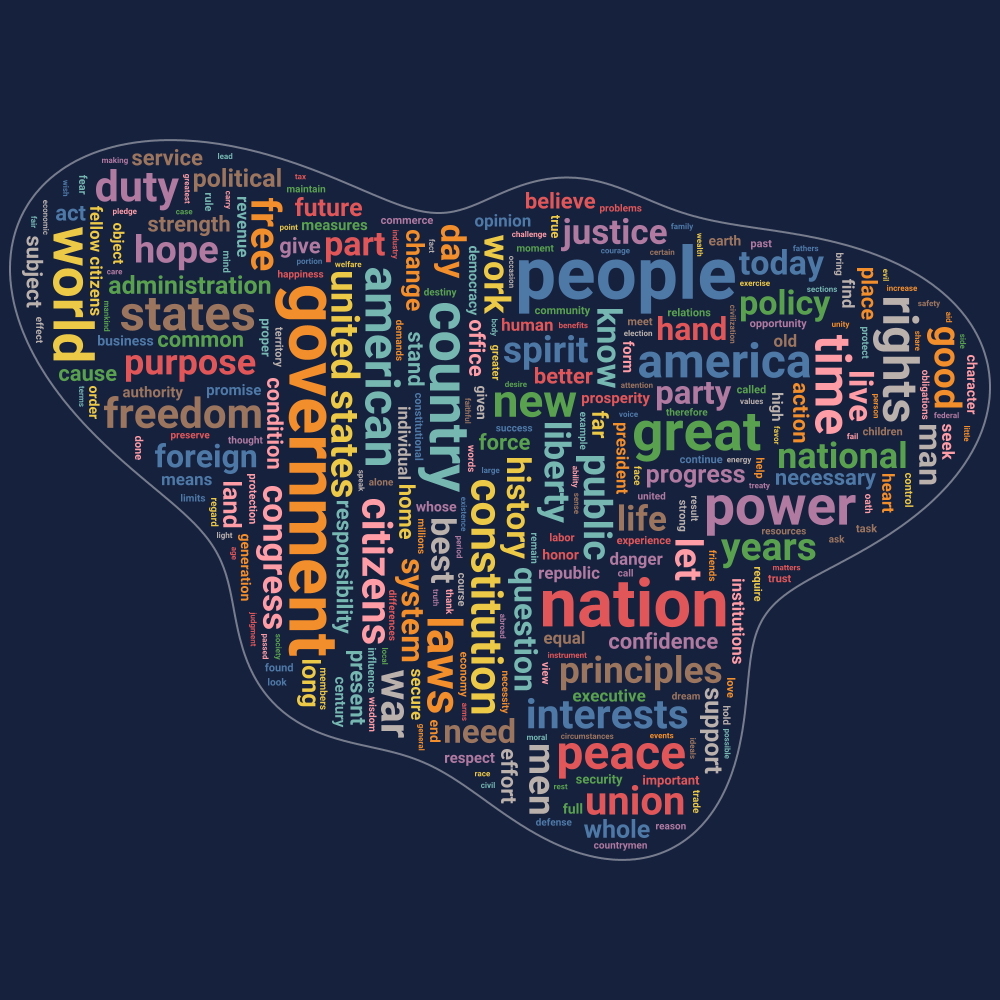</a><br><sub>from coordinates: <code>shapes()</code></sub></td>
<td><a href="https://fahad-mirza.github.io/calligram_Stata/examples/05b_blob_mask.html">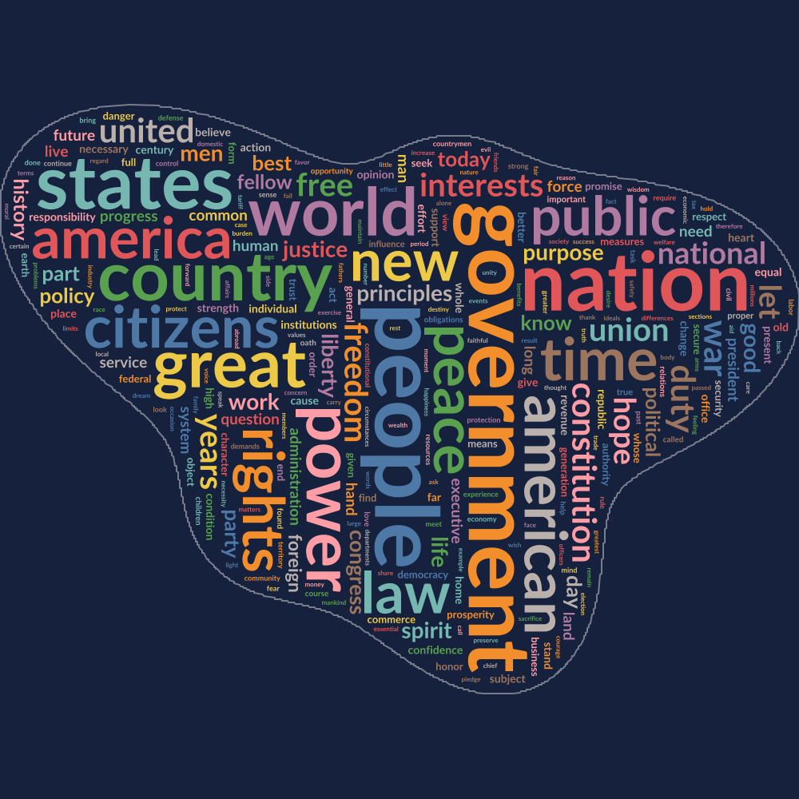</a><br><sub>from a picture: <code>mask()</code></sub></td>
</tr></table>

### Maps

#### Every city inside its own country
`shapes()` reads any Stata-format shapefile (made by `spshape2dta`). `location(lat lon)` puts each word in the area that contains its point, and size follows the count, here population. Longitude and latitude are drawn in the Equal Earth projection automatically.

```stata
use cg_cities, clear
calligram, wordvar(city) countvar(population) shapes(cg_countries_shp.dta) ///
    location(lat lon) outline outlinewidth(1) outlinecolor(#b8b8b8)          ///
    width(2400) height(1067) maxwords(1207) minfreq(1) minfontsize(4)        ///
    margin(2) font(Lato) bgcolor(white)                                      ///
    title("The world's cities, each in its own country")
```
<a href="https://fahad-mirza.github.io/calligram_Stata/examples/06_world.html">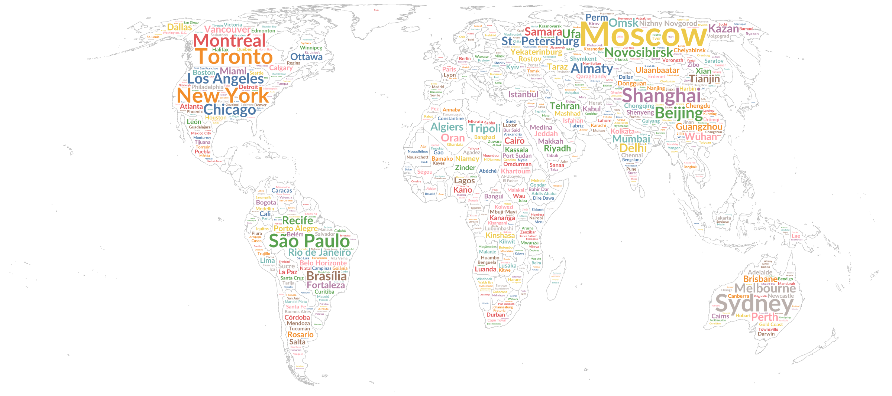</a>

#### ... each as close as possible to its real location
Add `near`:

```stata
calligram, wordvar(city) countvar(population) shapes(cg_countries_shp.dta) ///
    location(lat lon) near outline ...
```
<a href="https://fahad-mirza.github.io/calligram_Stata/examples/06_world_near.html"></a>

#### A continent, cut with ordinary Stata commands
```stata
use cg_countries, clear
keep if continent == "Africa"
keep _ID
merge 1:m _ID using cg_countries_shp, keep(match) nogenerate
sort _ID shape_order
save africa_shp, replace

use cg_cities, clear
calligram if continent == "Africa", wordvar(city) countvar(population) ///
    shapes(africa_shp.dta) location(lat lon) outline outlinewidth(1)    ///
    width(900) height(1280) minfreq(1) minfontsize(5) margin(2) font(Lato) ///
    title("Africa's cities")
```
<p align="center"><a href="https://fahad-mirza.github.io/calligram_Stata/examples/07_africa.html">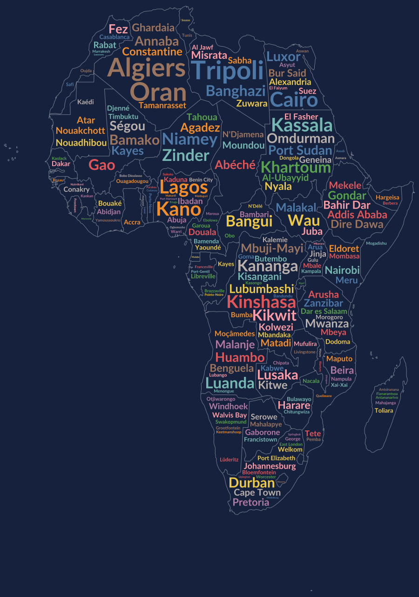</a></p>

#### ... with words turned to fill each country
A word in an area can be no wider than the area, so large countries with few cities in the data (Chad, Madagascar) look empty with horizontal words. `rotate(random)` lets words run along tall or narrow countries and fills them better; horizontal words are easier to read, so this is a choice, not the default.

```stata
calligram if continent == "Africa", wordvar(city) countvar(population) ///
    shapes(africa_shp.dta) location(lat lon) outline rotate(random)     ///
    width(900) height(1280) minfreq(1) minfontsize(5) margin(2) font(Lato)
```
<p align="center"><a href="https://fahad-mirza.github.io/calligram_Stata/examples/07b_africa_turned.html">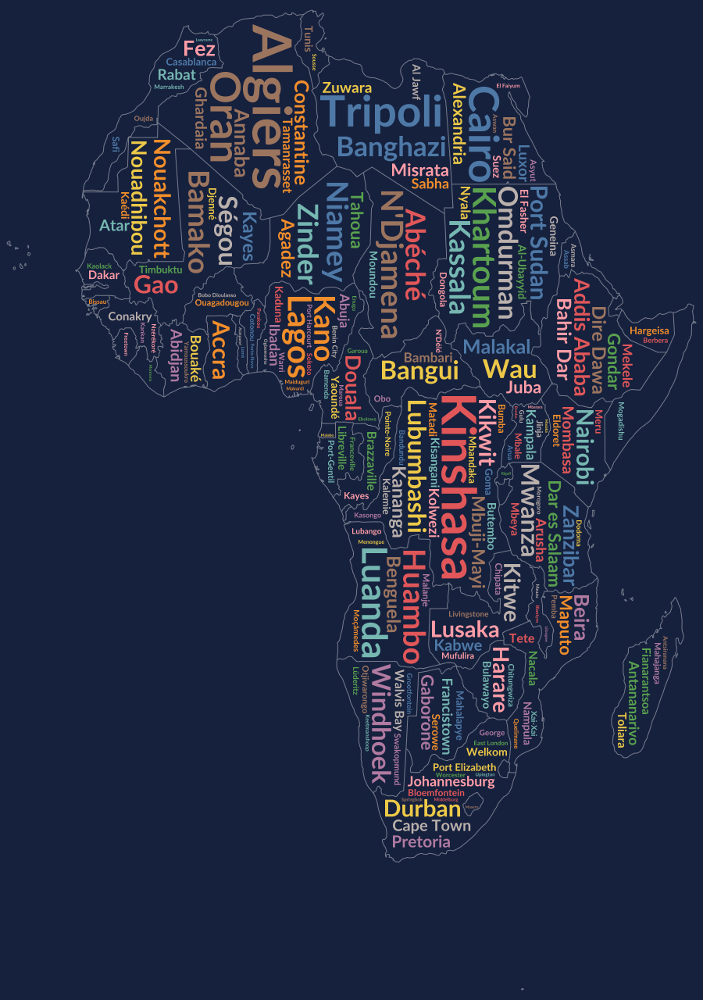</a></p>

**Small and thin countries.** Even without `rotate()`, a word that does not fit across a narrow country is turned to run along it (Lilongwe in Malawi, Lomé in Togo), and a word that fits nowhere with the usual clearance from coasts and borders is placed closer to the lines (Seoul, Lisbon, Taipei on the world map). Countries too small for any name at `minfontsize()` stay empty, and the Results window lists the places that did not fit, so a larger canvas or a smaller `minfontsize()` can bring them in.

### Working with text

#### Two-word phrases
`phrases` finds word pairs that belong together, such as "united states", "fellow citizens" and "civil war", using a likelihood test and a strength score. It shows each as one entry and lists them in the Results window. Use `addphrases()` and `dropphrases()` to adjust the list.

```stata
use cg_inaugural, clear
calligram, textvar(text) phrases maxwords(200) font(Merriweather) ///
    title("US inaugural addresses, 1789-2025")
```
<a href="https://fahad-mirza.github.io/calligram_Stata/examples/08_inaugural.html">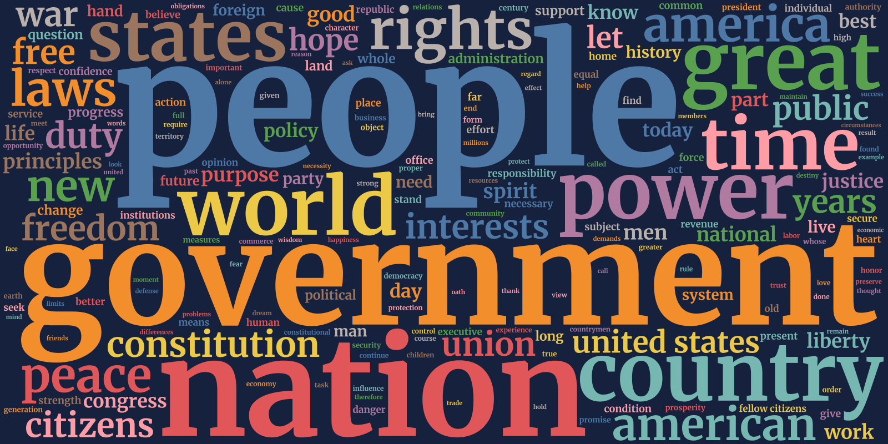</a>

#### One cloud per group
`by()` gives one cloud per group, as tabs on the same page. `image()` writes one picture per group.

```stata
calligram, textvar(text) by(century) phrases maxwords(120) font(Merriweather) ///
    image(by_century.png, replace)
```
<table><tr>
<td>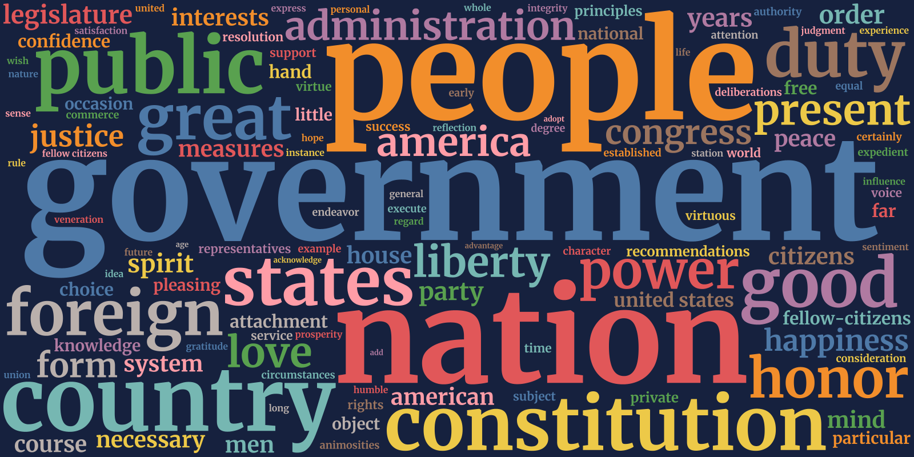<br><sub>18th century</sub></td>
<td>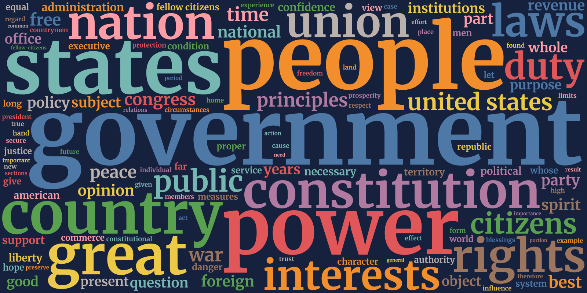<br><sub>19th century</sub></td>
</tr><tr>
<td>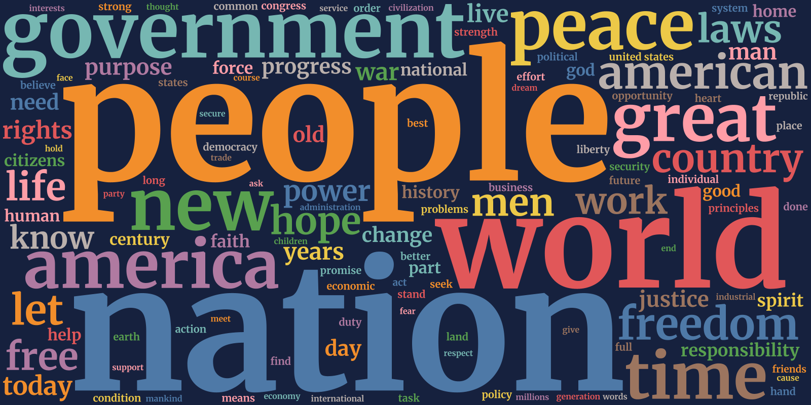<br><sub>20th century</sub></td>
<td>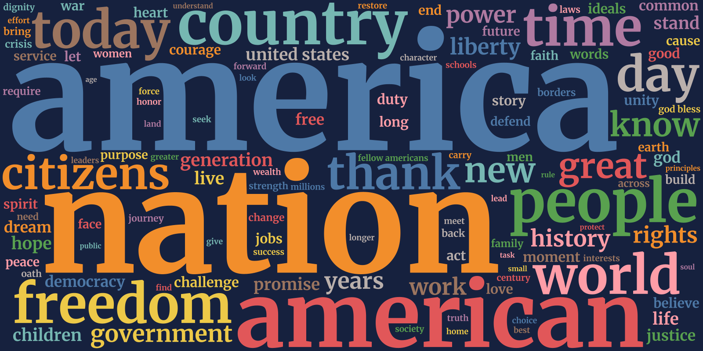<br><sub>21st century</sub></td>
</tr></table>

[Open the page with tabs](https://fahad-mirza.github.io/calligram_Stata/examples/09_by_century.html)

#### A book in a circle
*Alice's Adventures in Wonderland*. The phrases found include "mock turtle", "march hare", "white rabbit" and "cheshire cat".

```stata
use cg_alice, clear
calligram, textvar(text) phrases shape(circle) width(1000) height(1000) ///
    maxwords(250) minfreq(3) rotate(random) font(Merriweather)          ///
    bgcolor(#fdfaf3) gradient(#7b2d26 #33658a)
```
<p align="center"><a href="https://fahad-mirza.github.io/calligram_Stata/examples/10_alice.html">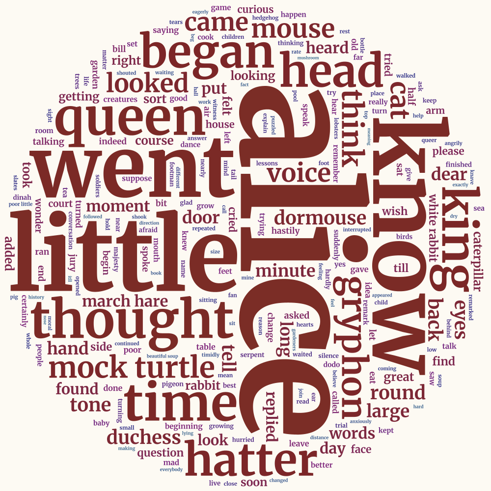</a></p>

#### Words you've already counted
`wordvar()` and `countvar()` take words and counts you've already computed, one row each. Here it's car makes in `sysuse auto`, sized by total price.

```stata
sysuse auto, clear
gen brand = word(make, 1)
calligram, wordvar(brand) countvar(price) minfreq(1) nostopwords ///
    shape(ellipse) font(Open Sans) bgcolor(white)
```
<a href="https://fahad-mirza.github.io/calligram_Stata/examples/11_auto.html">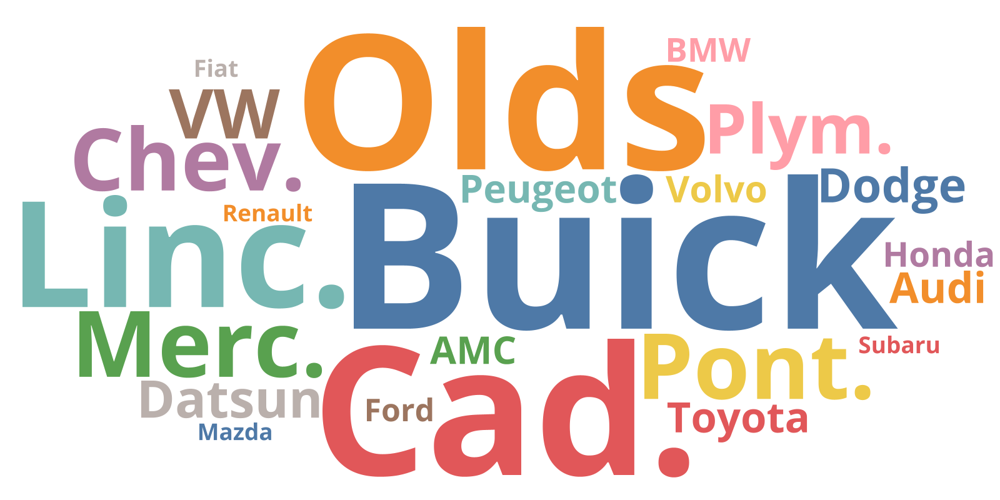</a>

#### Survey weights
`aweight` and `fweight` are supported. Each word counts with its response's weight.

```stata
calligram [aweight = weight], textvar(response) minfreq(1)
```
<a href="https://fahad-mirza.github.io/calligram_Stata/examples/12_weights.html"></a>

### Every language and writing system

Twenty languages in twelve writing systems, coloured by writing system: Latin, Cyrillic, Greek, Arabic script (Arabic, Persian, Urdu), Hebrew, Devanagari (Hindi), Bengali, Tamil, Thai, Chinese characters, Japanese and Hangul (Korean). From South Asia alone: Urdu, Hindi, Bengali and Tamil. Click a writing system in the key on the [live page](https://fahad-mirza.github.io/calligram_Stata/examples/20_languages.html) to hide or show it.

```stata
use cg_languages, clear          // short customer comments in 20 languages
calligram [fweight = responses], textvar(text) colorby(script) minfreq(1) ///
    maxwords(250) scaling(0.35) font(Lato) title("Customer comments in 20 languages")
```
<a href="https://fahad-mirza.github.io/calligram_Stata/examples/20_languages.html">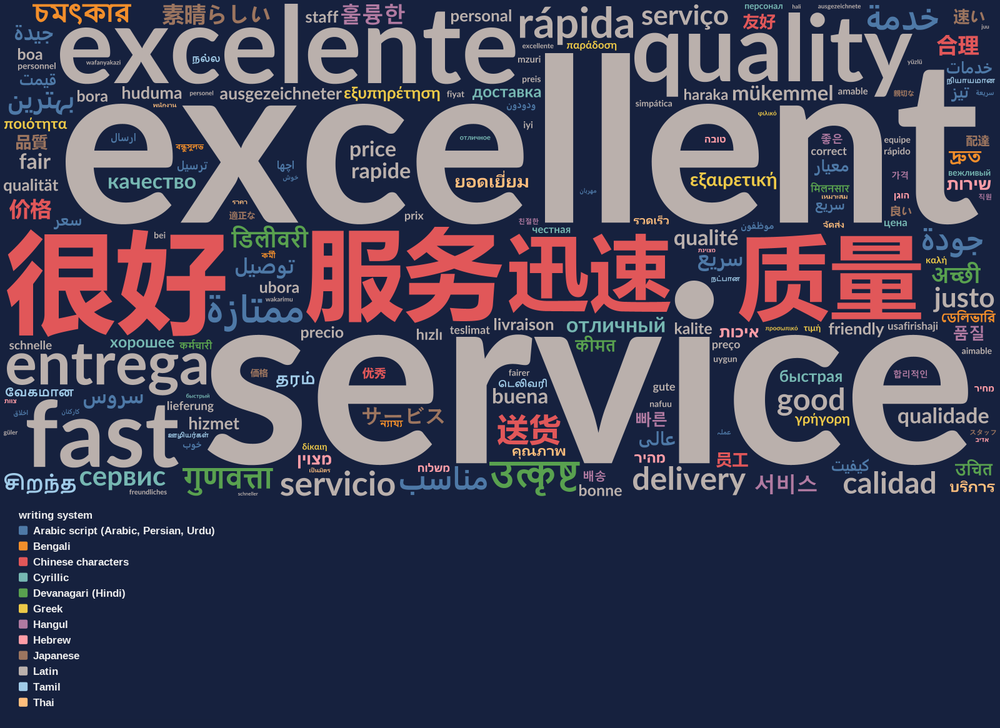</a>

What happens behind the scenes:

- **Fonts.** When the chosen font lacks a script, calligram picks one that covers it: on Windows Segoe UI (Urdu, Arabic, Persian, Hebrew, Greek, Cyrillic), Nirmala UI (Hindi, Bengali, Tamil), Microsoft YaHei (Chinese), Yu Gothic (Japanese), Malgun Gothic (Korean) and Leelawadee UI (Thai); the macOS and Noto equivalents elsewhere. The Results window says which it used. To choose a font yourself for any writing system, use `scriptfonts()`, as in the Urdu example below.
- **The page needs none of these fonts.** Each word is stored as its letter outlines, so it looks the same on every computer and phone.
- **Shaping and direction.** Urdu, Arabic and Persian letters join and run right to left, Hindi conjuncts form, and the marks of Bengali, Tamil and Thai stay in place, just as in a word processor.
- **Words stay whole.** Vowel signs, the virama and other marks belong to their word, never split it. For `minlength()`, a Chinese, Japanese or Korean character counts as two letters, since one or two characters often make a whole word.
- **One thing to do yourself:** Chinese, Japanese and Thai are written without spaces between words. Split the text into words first (with a segmenter such as jieba for Chinese, or a tokenizer such as MeCab for Japanese), as in the example data. Korean, which uses spaces, needs nothing.
- **Stopwords** are built in for English, French, Spanish and Portuguese (`language()`). For other languages, add your own with `stopwords()`.

### Urdu in Nastaliq

Urdu is usually written in **Nastaliq**, a flowing calligraphic style in which letters join on a sloping baseline and each word cascades diagonally. Most fonts draw Urdu in Naskh, the upright style used for Arabic: legible, but not how Urdu readers expect to see it. calligram bundles the free **Noto Nastaliq Urdu** font, and `scriptfonts()` chooses it for Arabic script. Here are short customer comments in Urdu:

```stata
use cg_urdu, clear               // customer comments in Urdu, with how many wrote each
calligram [fweight = responses], textvar(text) minfreq(1)          ///
    stopwords(اور تھی تھا ہے لیکن مگر بہت ہوئی ضرور کروں)            ///
    scriptfonts(arabic "Noto Nastaliq Urdu") shape(circle) bgcolor(#0b3d2e)
```
<p align="center"><a href="https://fahad-mirza.github.io/calligram_Stata/examples/21_urdu.html">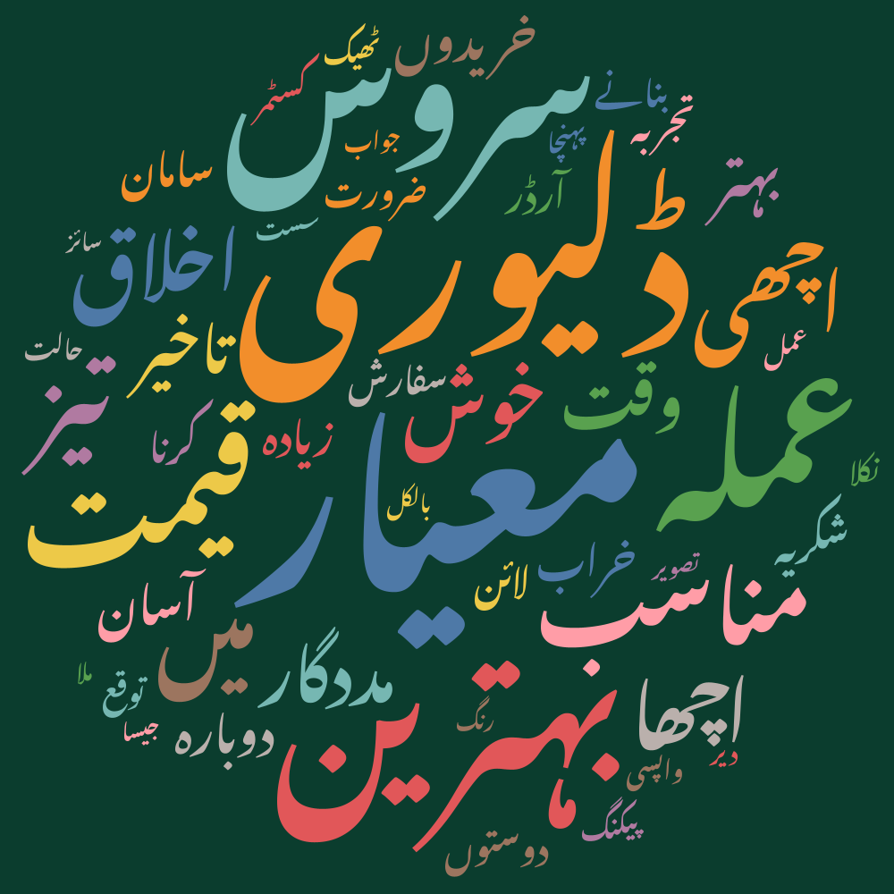</a></p>

Urdu has no built-in stopword list, so its common short words (اور *and*, تھا *was*, لیکن *but*, ...) are given with `stopwords()`; the same works for any language. `scriptfonts()` works for every writing system, for example `scriptfonts(chinese SimHei japanese "Yu Gothic")`, and the font is used for every word in that writing system, even when the main font could draw it.

### Colour with meaning

By default colours just tell words apart. Three options make them carry information. A key appears under the cloud and in pictures, and each word's hover card gives its value.

#### By a number: `colorby(numeric variable)`
Each word gets the average of the variable over the responses it appears in: a rating, a sentiment score, a year. `gradient(low high)` sets the colours.

```stata
use cg_inaugural, clear
calligram, textvar(text) colorby(year) gradient(#d95f02 #5e3c99) phrases ///
    maxwords(200) font(Merriweather) title("Inaugural addresses: words by average year")
```
<a href="https://fahad-mirza.github.io/calligram_Stata/examples/16_colorby_year.html">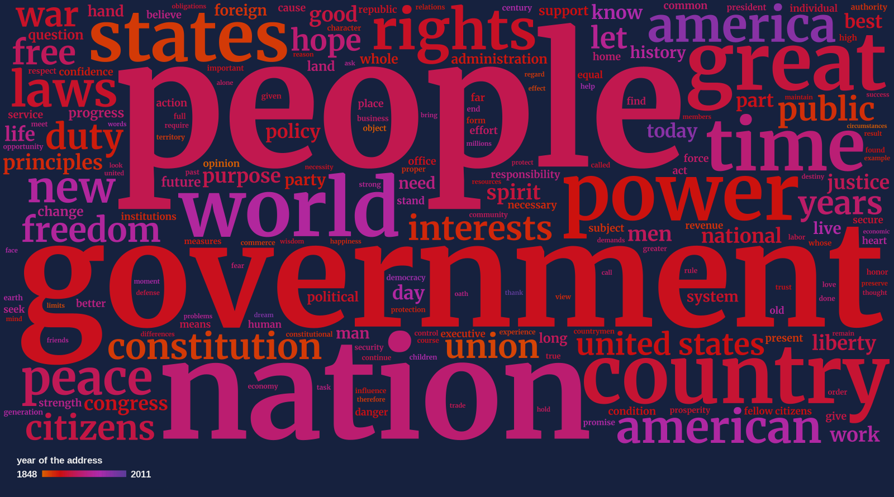</a>

#### By group: `colorby(categorical variable)`
Each word takes the colour of the group it is **most typical of**: the one where it is used significantly more often than its overall rate predicts (95% confidence). Words used about evenly are grey, so a small group can't claim common words by chance. The hover card says how many times as often the word is used there. On the page, **click a group in the key to hide or show its words.**

```stata
calligram, textvar(text) colorby(century) phrases maxwords(200) font(Merriweather) ///
    title("Inaugural addresses: words by century")
```
<a href="https://fahad-mirza.github.io/calligram_Stata/examples/17_colorby_century.html">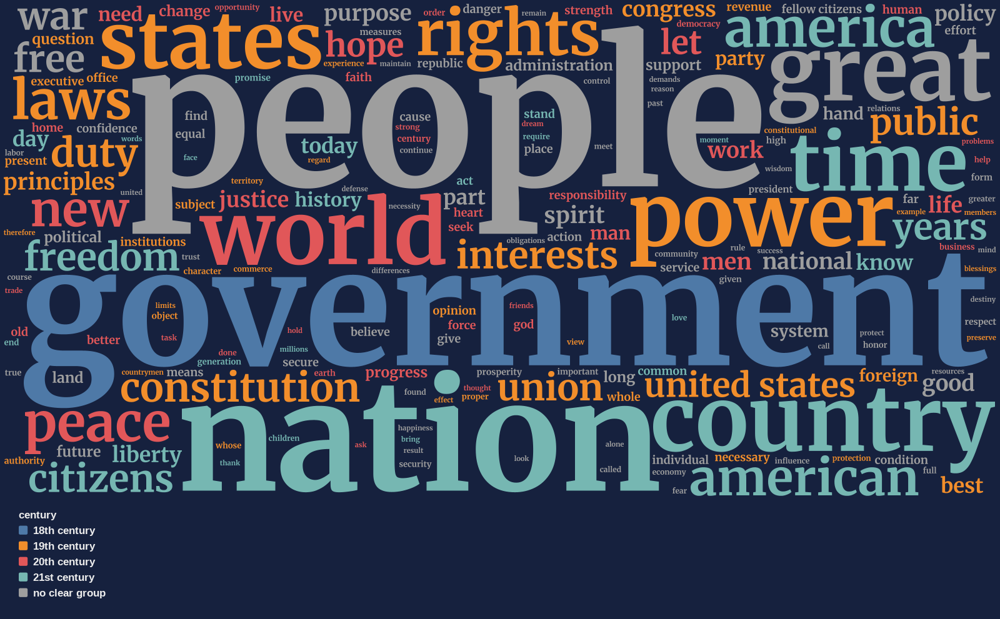</a>

String variables and labelled numeric variables are used as groups automatically. Add `, categories` for unlabelled codes.

```stata
sysuse auto, clear
gen brand = word(make, 1)
calligram, wordvar(brand) countvar(price) colorby(foreign) minfreq(1) nostopwords ///
    shape(ellipse) font(Open Sans) bgcolor(white)
```
<a href="https://fahad-mirza.github.io/calligram_Stata/examples/18_colorby_foreign.html">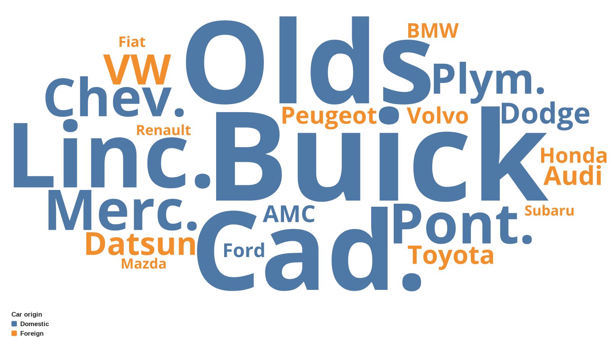</a>

#### A colour for each word, or colours from a picture
`colorvar()` (with `wordvar()`) takes a colour for each word, computed in Stata however you like. `colorimage()` gives each word the average colour of a picture under its letters. Here the picture is stripes drawn with `twoway bar`:

```stata
calligram, textvar(text) shape(heart) colorimage(stripes.png) ///
    width(1000) height(900) maxwords(250) rotate(random) bgcolor(white)
```
<p align="center"><a href="https://fahad-mirza.github.io/calligram_Stata/examples/19_colorimage.html">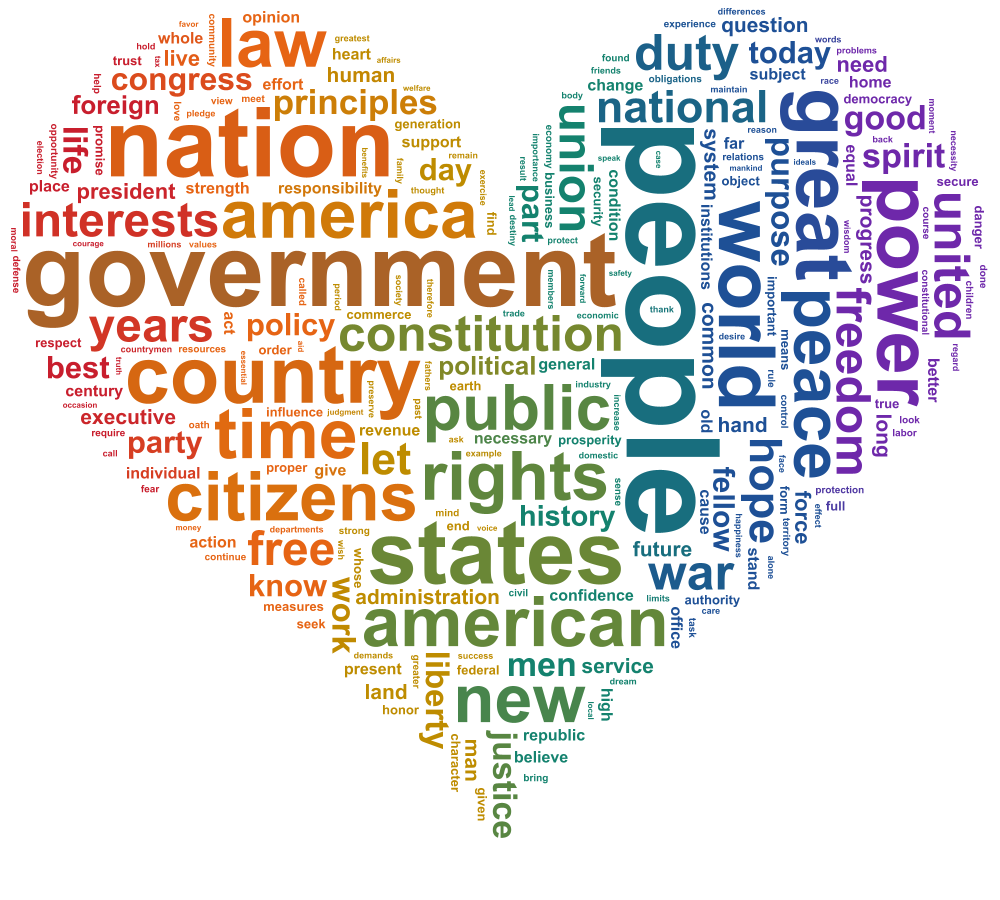</a></p>

### Results and speed

#### The cloud as a dataset
`saving()` keeps every word with its rank, count, size, position, rotation and colour, plus colour values or groups with `colorby()`.

```stata
use cg_inaugural, clear
calligram, textvar(text) phrases maxwords(100) saving(words, replace)
use words, clear
list rank word count fontsize in 1/10
```
```
  +--------------------------------------+
  | rank         word   count   fontsize |
  |--------------------------------------|
  |    1       people     642        290 |
  |    2   government     574        275 |
  |    3       nation     549        259 |
  |    4      country     367        200 |
  |    5        great     352        175 |
  ...
```

#### Big text, quickly
Counting runs on all processor cores (`threads()`). Times are from Stata 19 MP on an 8-core Windows machine, for the whole command:

| Text | Words counted | Time |
|---|---:|---:|
| 100,000 survey responses | 662,500 | 0.56 s |
| 50 copies of every inaugural address (81,800 paragraphs) | 2,970,650 | 0.65 s |
| the same, finding two-word phrases | 2,571,350 | 0.82 s |
| world map: 1,207 cities in 241 countries | | about 3 to 4 s |

#### Smaller pages with `online`
By default each word is stored as its exact letter outline, so the page looks identical everywhere and needs no internet connection. `online` writes words as text and loads the font from Google Fonts instead: much smaller files, but it needs an internet connection.

---

## The interactive page

Every cloud is a single self-contained HTML file. Open it in any browser and send it to anyone: nothing else is needed.

| | |
|---|---|
| **Search** | Type to highlight matching words (press <kbd>/</kbd>) |
| **Minimum count** | A slider hides words below a count |
| **Top words** | A ranked list with bars; click a word to hide or show it |
| **Hover card** | A word's count, rank, share of all mentions, and its value or group with `colorby()` |
| **Zoom and pan** | Scroll to zoom, drag to move, <kbd>0</kbd> to reset; the zoomed cloud uses the whole window. On maps and large clouds the picture moves smoothly while you scroll and sharpens as soon as you pause |
| **Colour key** | With `colorby()` groups, click a group to hide or show its words |
| **Tabs** | One per group with `by()` (<kbd>←</kbd> <kbd>→</kbd> to switch) |
| **Themes and palettes** | Light or dark background; switch palettes (<kbd>C</kbd>) unless colours carry meaning |
| **Save** | PNG, SVG or JPG of what's shown |
| **Help** | <kbd>?</kbd> lists all keyboard shortcuts |

`notoolbar` gives a plain page with no side panel, and `export(png)` then adds a single save button. `fixed` shows the cloud at its exact pixel size instead of fitting it to the window.

---

## Options

Full details: `help calligram`.

**Input**

| Option | What it does |
|---|---|
| `textvar(varname)` | string variable of free text |
| `wordvar(varname)` `countvar(varname)` | words or phrases you've already counted, and their counts (default 1 per row) |
| `by(varname)` | one cloud per group, as tabs |
| `[aweight]` `[fweight]`, `if`, `in` | weights and sample selection |

**Words**

| Option | What it does | Default |
|---|---|---|
| `maxwords(#)` | most words to show | 100 |
| `minfreq(#)` | fewest occurrences for a word to be shown | 2 |
| `minlength(#)` | shortest word | 3 |
| `language(list)` | stopword languages: `en fr es pt all` | `en` |
| `stopwords(list)` | extra words to remove | |
| `nostopwords` | keep all words | |
| `noclean` | keep case and punctuation | |
| `splithyphens` | split hyphenated words (*sci-fi* becomes *sci fi*) | kept whole |
| `noplurals` | don't merge plurals with singulars | merged |
| `phrases` | find two-word phrases | |
| `phrasestrength(#)` | how strongly the words must belong together | 0.4 |
| `addphrases(list)` `dropphrases(list)` | phrases always or never joined | |

**Shape and layout**

| Option | What it does | Default |
|---|---|---|
| `shape(name)` | rectangle, ellipse, circle, square, cloud, heart, diamond, triangle, star | rectangle |
| `mask(file)` | fill the dark area of a picture (PNG, JPG, GIF, BMP) | |
| `shapes(file_shp.dta)` | areas from a Stata-format shapefile | |
| `location(lat lon)` `near` | each word in the area containing its point; `near` keeps it close to the point | |
| `regions(varname)` | keep each word inside its own area | |
| `projection(name)` | auto, equalearth or none | auto |
| `outline` `outlinecolor()` `outlinewidth()` | draw the edge of the shape, mask or areas | |
| `width(#)` `height(#)` | canvas size in pixels | 1600 × 800 |
| `rotate(mode)` | none, 90 or random | none |
| `margin(#)` `spacing(#)` | gap between words in pixels, and extra clearance as a share of font size | 4, 0 |
| `minfontsize(#)` `maxfontsize(#)` `scaling(#)` | size range, and how strongly size follows count (0 to 1) | 8, automatic, 0.5 |
| `seed(#)` | a different arrangement | 42 |
| `threads(#)` | processor cores (0 = all) | 0 |

**Colour and look**

| Option | What it does | Default |
|---|---|---|
| `palette(name)` | any palette from Ben Jann's `colorpalette` | built-in |
| `gradient(c1 c2)` | from most to least frequent, or low to high with `colorby()` | |
| `colorby(varname[, categories])` | colour by a number (average) or by group (most typical) | |
| `colorvar(varname)` | a colour for each word (with `wordvar()`) | |
| `colorimage(file)` | colours from a picture | |
| `bgcolor(color)` | background | `#16213e` |
| `font(name)` | font for measuring and drawing | Arial |
| `scriptfonts(script font ...)` | the font for a writing system, e.g. `arabic "Noto Nastaliq Urdu"` (bundled) | automatic |
| `title("text"[, color() size()])` | page title | "Word Cloud" |

Colours can be hex (`#4e79a7`), `rgb(78,121,167)` or CSS names (`navy`, `tomato`).

**Output**

| Option | What it does | Default |
|---|---|---|
| `savefile(file.html)` | the interactive page | `calligram.html` |
| `image(file[, replace scale(#)])` | also a PNG, JPG or SVG picture | |
| `saving(file[, replace])` | the words, counts, sizes, positions and colours as a dataset | |
| `online` | words as text with Google Fonts (smaller files) | outlines, offline |
| `notoolbar` `export(fmt)` `fixed` | plain page, a single save button, exact pixel size | |

## Stored results

`r(N_obs)` (rows used), `r(N_words)` (words after filtering), `r(N_placed)` (words placed), `r(N_phrases)`, `r(N_groups)`, `r(maxfontsize)`, `r(savefile)`, `r(image)`, `r(saving)`, `r(shape)`, `r(java)` (1 if the Java engine was used), `r(online)`, `r(outline)`, `r(toolbar)`.

---

## How it works

1. **Counting** (Java, all cores): text is lower-cased and cleaned; contractions, accents, hyphens and French elisions are handled; stopwords are removed; plurals are merged with their singulars; and phrases are found with a likelihood-ratio test and a pointwise mutual information score.
2. **Sizing:** font sizes follow `count ^ scaling` and are fitted so that nearly all mentions fit in the shape.
3. **Packing:** each word is drawn as a pixel mask of its real letters and placed along a spiral at the first spot where no pixel touches another word. With areas (`shapes()`, `regions()`), each word is placed inside its own area, nearest its point with `near`.
4. **Writing:** the page stores each word's exact letter outline, or text with `online`. The same outlines produce the PNG, JPG and SVG pictures, so the picture matches the page exactly.

If Java isn't available, a simpler Mata layout is used instead (rectangles only).

## Requirements and troubleshooting

- **Stata 17 or newer.** Java is part of Stata, so there's nothing to install.
- **`r(java) == 0`** means the Java engine didn't run. Check that `calligram.jar` was installed (`which calligram`, then look for the JAR in the same folder) and reinstall with `replace`.
- **Words did not fit:** the Results window says how many. A larger canvas (`width()`, `height()`), a smaller `minfontsize()` or fewer `maxwords()` helps. On maps, small countries fill first.
- **Characters from other scripts** (Greek, Cyrillic, Arabic, Chinese and more) are drawn with a fallback font when the chosen font lacks them.
- **Large maps** make large pages (about 3 MB for 1,200 cities on a world map). They open in any browser.

## FAQ

**Can I use my own shapefile?** Yes. Convert it with `spshape2dta` and pass the `_shp.dta` file to `shapes()`. Each area becomes a region. Use `location()` for points, or `regions()` for an area ID per word.

**Can I put the cloud in a report?** Use `image(file.png, replace scale(2))` for a high-resolution picture, `image(file.svg)` for vector graphics, or the page's save buttons.

**Does it work offline?** Yes. Pages contain everything they need. Only `online` loads fonts from the internet.

**Why is a word grey with `colorby()`?** It isn't clearly more typical of any one group (or has no value). That's deliberate, so that small groups don't claim common words by chance.

## Example data

Copied by `net get calligram`:

| File | Contents | Source |
|---|---|---|
| `cg_inaugural.dta` | US presidential inaugural addresses 1789-2025, one row per paragraph | public domain |
| `cg_alice.dta` | *Alice's Adventures in Wonderland*, one row per paragraph | Project Gutenberg, public domain |
| `cg_languages.dta` | short customer comments in 20 languages and 12 writing systems, with how many customers wrote each | written for calligram |
| `cg_urdu.dta` | short customer comments in Urdu, with how many customers wrote each | written for calligram |
| `cg_cities.dta` | 1,207 cities with latitude, longitude, population, country and continent | Natural Earth, public domain |
| `cg_countries.dta`, `cg_countries_shp.dta` | 241 countries in Stata shapefile format | Natural Earth, public domain |

## Credits and licence

Author: **Fahad Mirza**. Bundled fonts (Arimo, Tinos, Roboto, Open Sans, Lato, Noto Sans, Merriweather, Noto Nastaliq Urdu) are used under their open licences, included in the JAR. Map data © Natural Earth (public domain).

Please report bugs and ideas in [Issues](https://github.com/fahad-mirza/calligram_Stata/issues). See [LICENSE](LICENSE) for the licence.
